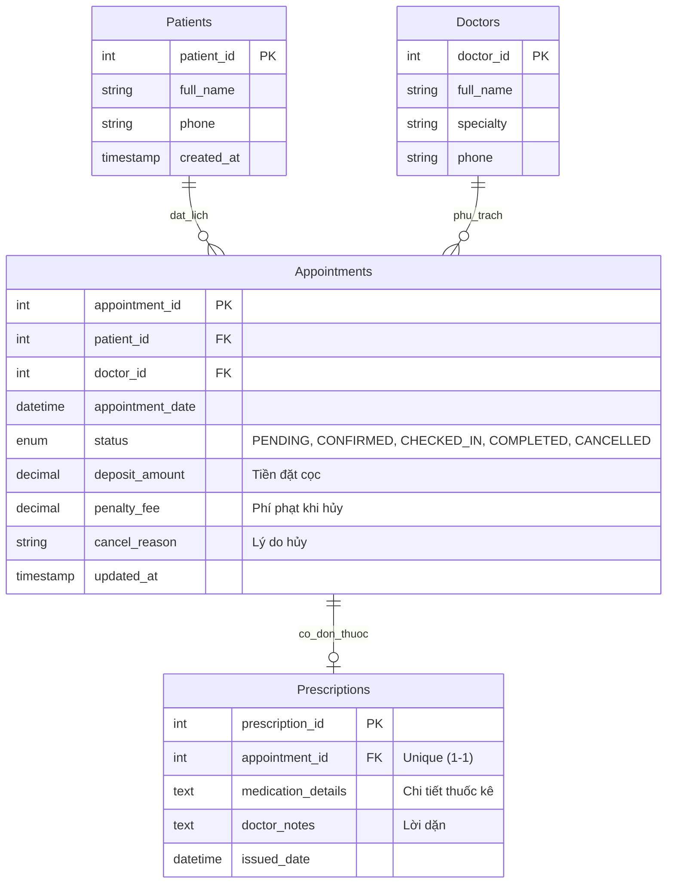

# Khủng Hoảng Tại Phòng Khám HealthSync: Khi Lập Trình Viên "Bỏ Quên" Nghiệp Vụ

## 🎯 Giới thiệu dự án
Dự án giải quyết bài toán khủng hoảng thiết kế cơ sở dữ liệu tại **Phòng khám Đa khoa HealthSync**. Hệ thống phần mềm đặt lịch và khám bệnh gặp sự cố nghiêm trọng do cơ sở dữ liệu MySQL của lập trình viên backend hoàn toàn "vênh" (không khớp) với quy trình nghiệp vụ (UML Activity Diagram) mà chuyên viên phân tích nghiệp vụ (BA) đã đưa ra.

---

## 📑 Các hồ sơ tài liệu trong dự án

Dự án bao gồm đầy đủ 3 tài liệu nộp bài chính theo yêu cầu cùng tài liệu mở rộng:

1. **[healthsync_db.sql](file:///C:/Users/ductr/.gemini/antigravity-ide/scratch/healthsync-clinic/healthsync_db.sql)**:  
   Kịch bản SQL hoàn chỉnh định nghĩa CSDL tái cấu trúc, thiết lập kiểu dữ liệu tài chính `DECIMAL`, vòng đời `ENUM`, Database Trigger chống kê đơn sai quy định, và 2 kịch bản dữ liệu mô phỏng nghiệp vụ thực tế.
2. **[consistency_report.md](file:///C:/Users/ductr/.gemini/antigravity-ide/scratch/healthsync-clinic/consistency_report.md)**:  
   Báo cáo chẩn đoán khoảng cách (Gap Analysis) chỉ ra 4 lỗ hổng cốt tử của hệ thống cũ và trả lời chi tiết 3 câu hỏi bảo vệ thiết kế trước Giám đốc phòng khám.
3. **[ai_prompt_log.md](file:///C:/Users/ductr/.gemini/antigravity-ide/scratch/healthsync-clinic/ai_prompt_log.md)**:  
   Nhật ký tương tác kỹ thuật với AI (Data Modeling Assistant) về rủi ro số chấm động, anti-pattern cờ boolean, và chiến lược khóa ngoại.
4. **[index.html](file:///C:/Users/ductr/.gemini/antigravity-ide/scratch/healthsync-clinic/index.html)**:  
   Giao diện web trực quan mô phỏng luồng Activity Diagram, so sánh Legacy vs Optimized ERD và bảng điều khiển dữ liệu khám bệnh.

---

## 🔄 So sánh Lưu đồ nghiệp vụ (Activity Diagram) và ERD tối ưu

### 1. Luồng nghiệp vụ (State Lifecycle Flow):
```text
[Bệnh nhân đặt lịch] 
        │
        ▼
   ( PENDING ) ──[Nộp tiền cọc]──► ( CONFIRMED )
                                         │
                 ┌───────────────────────┴───────────────────────┐
                 ▼                                               ▼
          [Hủy lịch hẹn]                                  [Đến phòng khám]
                 │                                               │
                 ▼                                               ▼
          ( CANCELLED )                                   ( CHECKED_IN )
   [Phạt cọc & Hoàn tiền dư]                                     │
                                                                 ▼
                                                          [Bác sĩ khám xong]
                                                                 │
                                                                 ▼
                                                          ( COMPLETED )
                                                                 │
                                                                 ▼
                                                          [Kê đơn thuốc]
```

### 2. Sơ đồ thực thể liên kết tối ưu (Optimized ERD):



---

## 🧪 Kịch bản thử nghiệm thực tế (Trong `healthsync_db.sql`)

- **Kịch bản 1 (Quy trình thành công trọn vẹn):**  
  Bệnh nhân `Trần Minh Tuấn` đặt lịch `PENDING` cọc 500.000đ &rarr; Lễ tân chuyển sang `CONFIRMED` &rarr; Bệnh nhân đến khám `CHECKED_IN` &rarr; Bác sĩ khám xong `COMPLETED` &rarr; Kê đơn thuốc với 2 loại thuốc Paracetamol & Augmentin.
- **Kịch bản 2 (Hủy lịch và thu phí phạt cọc):**  
  Bệnh nhân `Nguyễn Thị Bích` đã cọc 300.000đ (`CONFIRMED`) &rarr; Báo hủy lịch đột xuất &rarr; Cập nhật `CANCELLED`, lý do `"Bận việc đột xuất"`, phạt `150.000đ` &rarr; Kế toán hoàn trả lại `150.000đ`.
- **Kịch bản 3 (Phòng vệ bằng Trigger):**  
  Cố tình kê đơn thuốc cho lịch hẹn chưa khám &rarr; Database Trigger lập tức chặn đứng với lỗi:  
  `Lỗi nghiệp vụ: Chỉ được kê đơn thuốc cho lịch hẹn có trạng thái COMPLETED!`

---

## 🚀 Đẩy mã nguồn lên GitHub Repository

```bash
cd C:\Users\ductr\.gemini\antigravity-ide\scratch\healthsync-clinic
git push -u origin main
```
